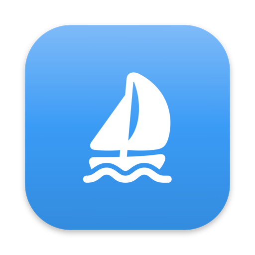
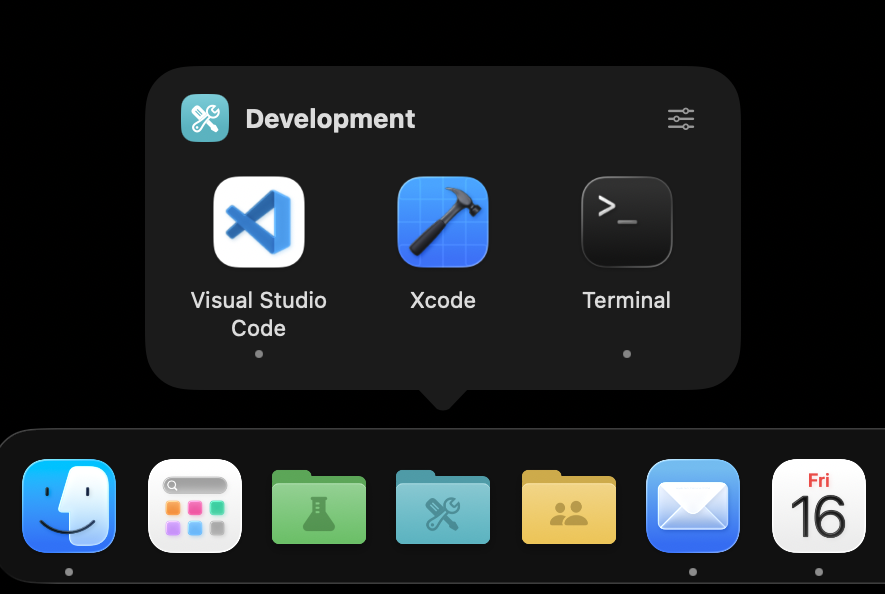
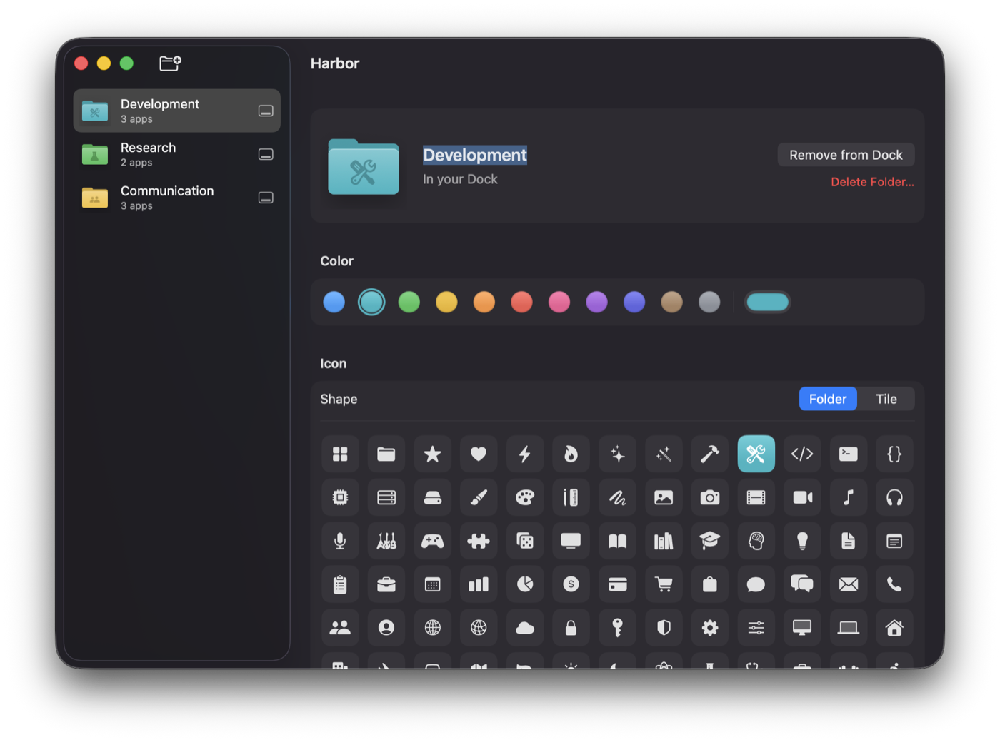

<p align="center">
  
</p>

<h1 align="center">Harbor</h1>

<p align="center">
  Better dock organization on macOS
</p>

<p align="center">
  
</p>

When you have a lot of apps pinned on your Mac, you don't just need a *dock*, you need a **Harbor**.

Harbor puts folders of apps in the Dock. Click it and a popover of its apps opens above the tile; click an app to launch it.

## Features

- **Folders in the Dock**: as many as you like, alongside your pinned apps.
- **Custom icons**: 11 colors (or any custom color), about 90 curated SF Symbols, and a folder or tile shape.
- **Quick launching**: click a folder to see its apps; running apps show a dot. Right-click the tile for a menu of its apps.
- **Four styles**: Grid, Compact Grid, List or Fan (like the Dock's own fan), chosen in Harbor › Settings.
- **Simple editing**: add apps from a searchable list or by dragging them in from Finder, and drag to rearrange.
- **Automatic updates**: downloaded copies update themselves with [Sparkle](https://sparkle-project.org). Turn checking on or off in Harbor › Settings, or choose Harbor › Check for Updates….

<p align="center">
  
</p>

## Requirements

- macOS 26 Tahoe or later
- Xcode 26 or later, to build from source

## Install

### Direct Download

Download `Harbor-<version>.zip` from the [latest release](https://github.com/griffhurt/harbor/releases/latest), unzip it, and move **Harbor** to your Applications folder.

### Homebrew

```sh
brew install --cask griffhurt/tap/harbor
```

To update later, run `brew upgrade --cask harbor`.

### From Source

```sh
git clone https://github.com/griffhurt/harbor.git
cd harbor
scripts/build.sh --install
```

This builds `Harbor.app`, copies it to `~/Applications`, and opens it. To build without installing, run `scripts/build.sh`; the app ends up in `build/Harbor.app`.

The build is signed ad hoc for your Mac. If you copy it to another Mac, macOS will block it the first time it opens. To allow it, go to **System Settings → Privacy & Security** and click **Open Anyway**.

## Usage

1. Open Harbor and click the **New Folder** button in the toolbar.
2. Name the folder, then pick a color, a shape and a symbol.
3. Click **Add Apps…**, or drag apps in from Finder. Drag apps to rearrange them; the order matches the popover.
4. Click **Add to Dock**.

Click the folder in the Dock to open it, and click again or press Esc to close it. To change how all folders open, choose **Harbor › Settings…** (⌘,). The button in the popover's corner (or the folder's name at the top of a fan) opens that folder in Harbor.

Harbor quits when you close its window. Folders in the Dock keep working without it.

> [!NOTE]
> Adding a folder to the Dock, or changing the name or icon of a folder that's already there, restarts the Dock so it picks up the change. The Dock briefly disappears and comes back.

## How it works

macOS doesn't let apps create custom stacks in the Dock, so each folder is a small app of its own:

- **Harbor.app** (`Sources/Harbor`) is the editor. Folders are saved to `~/Library/Application Support/Harbor/folders.json`.
- **Add to Dock** generates `~/Applications/Harbor Folders/<Name>.app` with the folder's icon, and adds it to the Dock's pinned apps (`persistent-apps` in `com.apple.dock`).
- **HarborStub** (`Sources/HarborStub`) is the program inside every folder app. It runs in the background without a Dock icon of its own, and shows the popover above the tile when the tile is clicked. Because it can't ask the Dock where the tile is, it places the popover at the mouse position.
- **HarborKit** (`Sources/HarborKit`) holds the shared model, storage, icon rendering and popover UI.

The folder shape is applied as a custom icon (the kind Finder's Get Info sets). macOS 26 shrinks non-square `.icns` app icons onto a gray tile in the Dock, but leaves custom icons as they are.

## Uninstall

1. In Harbor, click **Remove from Dock** for each folder (or drag the tiles out of the Dock).
2. Delete these:
   - `Harbor.app`, from `/Applications` or `~/Applications`
   - `~/Applications/Harbor Folders`
   - `~/Library/Application Support/Harbor`

If you installed with Homebrew, `brew uninstall --zap --cask harbor` does step 2 for you.

## Development

```sh
swift build   # build
swift test    # run the tests
```

You can also open `Package.swift` in Xcode. The tests use Swift Testing. They cover the folder model and storage, icon rendering, the popover shape, and the Dock preference editing. The Dock tests only edit in-memory lists and never touch your real Dock.

`scripts/build.sh` puts the two executables together into an app bundle: `Harbor` goes in `Contents/MacOS`, `HarborStub` goes in `Contents/Helpers`, `Sparkle.framework` goes in `Contents/Frameworks`, and the app icon is rendered by `HarborStub --render-icon`. If you change the icon code, regenerate `docs/logo.png` with:

```sh
"$(swift build --show-bin-path)/HarborStub" --render-icon /tmp/logo.icns sailboat.fill 3A9BF5 tile
sips -s format png -z 512 512 /tmp/logo.icns --out docs/logo.png
```

## License

[MIT](LICENSE) © 2026 Griffin Hurt
